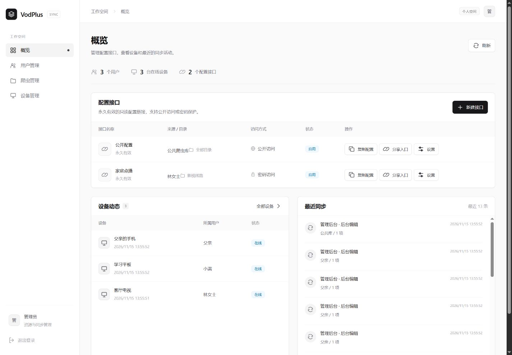

# VodPlus Sync

借 Cloudflare Workers 的免费额度，搭一个自己的数据同步、备份和恢复服务。

手机、电脑、电视，或者你自己写的小工具，都可以把数据和文件存到同一个地方：在一台设备上推送，再到另一台设备下载，让多端保持一致。一个后台可以创建多个用户或角色，每个人的数据独立保存，也能给同一个人绑定多台设备。

适合个人项目、家庭设备和小范围使用。服务运行在 Workers 上，数据存入 D1，不用单独维护服务器。

## 能做什么

- **多用户、多设备**：按用户隔离数据，通过设备码绑定，随时撤销设备访问。
- **数据备份与恢复**：保存 JSON 记录和文件，支持指定范围推送、完整备份与增量恢复。
- **按需上传**：先比对内容摘要，相同项目直接跳过，只传新增或修改的内容。
- **分包下载**：服务端计算变化，分批发送记录和文件；应用成功后确认进度，中断可以重新恢复。
- **文件管理**：目录列表、拖放上传、在线编辑、重命名、回收站和历史版本。
- **同步规则**：设置文件后缀和排除目录，过滤不需要备份的内容。
- **只读分享**：将文件目录发布为访问链接，可公开使用或设置密码。
- **网页管理**：管理用户、设备、文件、密码和服务重置。

## 一键部署到 Cloudflare

准备好 Cloudflare 和 GitHub 账号，点击下方按钮：

<!-- deploy-button:start -->
[](https://deploy.workers.cloudflare.com/?url=https%3A%2F%2Fgithub.com%2F0o755%2Fvodplus-sync)
<!-- deploy-button:end -->

连接 Git 账号，设置项目名称，选择 D1 数据库，然后部署。构建命令为 `npm run build`，部署命令为 `npm run deploy`。

部署成功后打开服务地址，创建管理员账号。接下来创建用户、生成设备码，就可以接入客户端了。

当前存储重建步骤会初始化为空数据；部署到有数据的数据库前，请先保存需要保留的内容。

[查看完整部署步骤](docs/DEPLOY.md)

## 客户端怎么接

只需要完成四件事：

1. 使用设备码绑定，取得访问令牌。
2. 给应用的数据选择一个命名空间，例如 `com.example.notes`。
3. 推送 JSON 记录和相对路径文件。
4. 下载恢复包，应用到本机，成功后确认。

服务端处理记录版本、文件去重和恢复差异。客户端负责把自己的数据转换为 JSON，并读写本地文件。

[API 总览](docs/PROTOCOL.md) · [数据同步 API](docs/SYNC_V2.md) · [接入指南](docs/APP_INTEGRATION.md) · [JavaScript SDK](examples/sync-v2-client.js)

## 后台预览



[文件管理](docs/ui-files.jpg) · [上传文件](docs/ui-upload.jpg) · [设备配置](docs/ui-device-config.jpg)

## 本地运行

需要 Node.js 22 或以上版本。

```sh
npm ci --ignore-scripts
npm run dev
```

打开终端显示的地址，创建管理员。开发、测试和打包说明见 [开发指南](docs/VALIDATION.md)。

## 使用范围

免费额度适合轻量数据和小文件。当前单文件上限为 **1.5 MiB**，文件清单最多 **5000 项**（含目录与删除标记），每个用户最多 **5000 条结构化记录**。文件清单集中存为 JSON，正文使用原始 BLOB；历史内容和索引也占用数据库空间。

D1 免费计划单库上限为 **500 MB**，具体额度见 [部署与容量说明](docs/DEPLOY.md)。

## 文档

| 文档 | 内容 |
| --- | --- |
| [部署指南](docs/DEPLOY.md) | 一键部署、自动发布、自定义域名和容量 |
| [使用指南](docs/USAGE.md) | 用户、设备、文件、同步规则和分享 |
| [API 总览](docs/PROTOCOL.md) | 请求约定、鉴权、设备绑定和分享接口 |
| [数据同步 API](docs/SYNC_V2.md) | 数据推送、文件上传、清单发布和恢复 |
| [客户端接入](docs/APP_INTEGRATION.md) | 数据组织、SDK 和本地应用流程 |
| [设备配置 API](docs/DEVICE_CONTROL.md) | 配置下发、状态读取和设备回报 |
| [账号与重置](docs/ACCOUNT_RECOVERY.md) | 修改密码和恢复初始状态 |
| [架构说明](docs/ARCHITECTURE.md) | 模块职责、存储和事务 |
| [开发指南](docs/VALIDATION.md) | 本地开发、测试与贡献检查 |
| [图标署名](docs/ICON_SOURCES.md) | 图标来源和许可 |

## 许可

仓库尚未提供项目整体的开源许可证。第三方图标按其 [MIT 许可](docs/ICON_LICENSE.txt) 分发。
