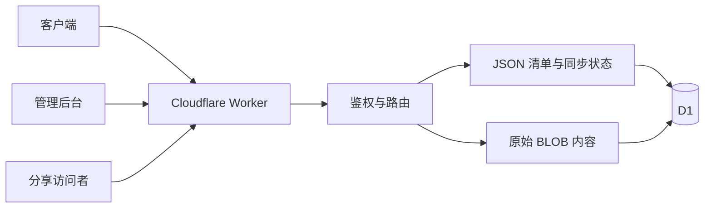

# 架构说明

## 请求流

Worker 提供 HTTP API 和管理页面，D1 保存账号、设备、JSON 文档、结构化记录、文件内容和历史。

## 模块

| 目录或文件 | 职责 |
| --- | --- |
| `src/worker.js` | 路由、错误响应和安全响应头 |
| `src/auth.js` | 管理员认证、设备绑定与鉴权 |
| `src/storage/catalog.js` | 数字 ID、目录关系和文件清单 |
| `src/storage/documents.js` | JSON 文档读取、分片和修订号校验 |
| `src/storage/file-transaction.js` | 清单、正文、发布状态和历史的原子提交 |
| `src/storage/content.js` | 原始 BLOB、内容去重和读取 |
| `src/generic/` | 数据推送、文件比对、发布确认和分包恢复 |
| `src/sync/` | 结构化记录、变化记录与同步规则 |
| `src/devices/` | 设备配置与回报 |
| `src/shares.js` | 只读分享和资源访问 |
| `src/schema/`、`migrations/` | 数据库结构与格式标记 |
| `web/`、`styles/` | 管理页面和 Tailwind 样式 |

## 文件清单

每个用户空间保存一份目录 JSON，包含递增的 nextId 和以数字 ID 索引的项目。

文件和目录使用稳定的数字 ID；parent 指向父目录，根目录为 0。重命名和移动保留 ID，删除后创建同名文件会分配新 ID。客户端使用 API 返回的访问标识，不自行分配服务端编号。

清单保存名称、类型、内容指纹、完整校验值、大小、状态及版本元信息。路径由目录关系计算。管理页面刷新文件列表时直接读取清单，不扫描逐文件元信息表。

## 文件正文

每份内容保存在 `file_contents` 的一行 BLOB 中，包含数字内容 ID、所属空间、完整 SHA-256、字节数和正文。相同空间中的相同内容复用存储。

快速比较使用 SHA-256 前 128 bit；完整校验值用于内容寻址和校验。正文不可变，文件更新引用另一份内容，恢复任务和历史版本因此可以继续读取固定字节。

单文件上限为 1.5 MiB，不进行 Base64 存储编码。

## JSON 文档

`json_documents` 保存：

| 文档 | 内容 |
| --- | --- |
| 文件清单 | 数字 ID、目录树和文件元信息 |
| 发布清单 | 当前任务提交的路径、指纹和规则 |
| 设备文件状态 | 已确认文件 ID/指纹，以及可能已应用的路径 |
| 文件恢复快照 | 固定的文件清单、变化项目和页面标记 |

普通文档使用一行。超过 1,400,000 字节时，按 UTF-8 边界自动分片；单文档最多 16,000,000 字节。读取时检查片段数量与修订号，组装完成后再解析 JSON。

每个文档具有修订号。保存必须通过 CAS 校验；多个请求同时修改时，失败方重新读取并合并，不会直接覆盖其他请求的内容。

## 原子发布

文件写入以目录文档作为事务入口：

1. 核对目录、发布状态和规则的当前修订。
2. 保存目录 JSON 与本次操作回执。
3. 写入原始 BLOB。
4. 更新发布状态、历史及变化记录。
5. 同一事务成功后，对外返回结果。

任一步失败都会回滚。相同操作标记和相同内容重试返回原结果。

完整发布先收集摘要清单，一致项直接登记，需要上传的项目再发送正文。finish 再核对当前清单，全部就绪后才删除范围内遗漏项；规则排除项保留。

## 恢复与确认

文件恢复从目录 JSON 和设备状态 JSON 计算差异，比较工作在 Worker 内完成。恢复会话保存固定 JSON 快照，通过页面标记分批读取；文件正文按快照中的校验值读取。

已知路径会保留到成功确认，用于处理中断后需要补发的删除通知。客户端全部应用成功后，再原子更新设备状态。其他设备的变化、规则变化和完整恢复请求都不会被跳过。

用户空间修订与设备确认摘要还会保存为紧凑 JSON。所选范围无变化时返回轻量空会话，不重复生成文件清单快照。

## 结构化记录与权限

结构化数据按 `namespace + key` 定位，保存在 `entities`。其发布与恢复按批次处理。文件清单和结构化记录独立查询，文件页面不读取用户记录正文。

管理员使用 Cookie，设备使用 Bearer 令牌。服务端从凭证确定用户空间。分享令牌只允许访问发布范围，不能调用设备同步接口。

## 初始化与生命周期

存储重建会初始化空业务数据。格式标记 `storage_format` 与迁移日志共同保证重建只执行一次；常规结构修复不重复清空数据。

每天 03:17 UTC 清理过期凭证、传输会话和临时 JSON 快照。当前清单、设备确认状态和历史内容保留。

文件清单最多 5000 项，每个用户最多 5000 条结构化记录。正文、JSON 文档、历史和索引都计入 D1 容量，套餐额度见 [部署指南](DEPLOY.md#免费额度与容量)。
